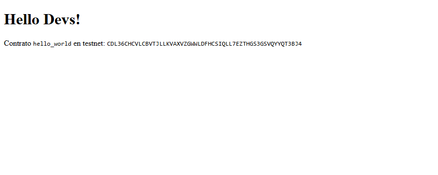

# Getting Started

Evidencia de que el equipo instaló el entorno y desplegó su primer contrato en testnet.
Guía que seguimos: [Getting Started de contratos](https://developers.stellar.org/docs/build/smart-contracts/getting-started).

| Dato | Valor |
|---|---|
| Lo hizo | André Landinez (Técnico) |
| Sistema operativo | Windows 11 |
| Fecha | 2026-10-27 |

## 1. Entorno

Salida de los comandos, copiada de la terminal como texto (no como captura).

```
$ rustc --version
rustc 1.93.1 (01f6ddf75 2026-02-11)

$ stellar --version
stellar 23.1.4 (4b99a259b43aef27ca0ca07134ffe293b3f748bc)
stellar-xdr 23.0.0 (e83a6337204ecfdb0ac0d44ffb857130c1249b1b)
xdr curr (4b7a2ef7931ab2ca2499be68d849f38190b443ca)
```

## 2. Mínimo · paso 2: hello_world en testnet

| Dato | Valor |
|---|---|
| Red | Testnet |
| Cuenta que desplegó | `alice` · `GAOKEU3JCLOTL3DY55HRKFYQJJDFFAR5CFSMJUHFAU42KPB5IKOVAUZ6` |
| Contract ID | `CDL36CHCVLCBVTJLLKVAXVZGWWLDFHCSIQLL7EZTHGS3GSVQYYQT3BJ4` |
| Enlace en stellar.expert | https://stellar.expert/explorer/testnet/contract/CDL36CHCVLCBVTJLLKVAXVZGWWLDFHCSIQLL7EZTHGS3GSVQYYQT3BJ4 |
| Hash del invoke de `hello` | `7ad9334a21f62adedf191ed2c40c93d9e662ca1c0f30f8657d295fc54a29b63d` |
| Resultado del invoke | `["Hello","Javeriana"]` |

## 3. Reto · paso 5: frontend de Hello World

Opcional. Llegamos al paso 5: los pasos 3 y 4 despliegan el contrato `increment` y el paso 5 conecta un frontend al contrato.

| Dato | Valor |
|---|---|
| Contract ID de `increment` | `CCYA2WPUQZCZCU5SOMVY4ZVAHJIBM6P5SKYUV6P4JUH66PQ5ST5HO5I4` |
| Enlace en stellar.expert | https://stellar.expert/explorer/testnet/contract/CCYA2WPUQZCZCU5SOMVY4ZVAHJIBM6P5SKYUV6P4JUH66PQ5ST5HO5I4 |
| Invokes de `increment` | `69a9c17f5617cfba290d93f1613f004ff1eba2f8d431fb55a6ba7782b53c6dd8` (devolvió 1) y `78ce53948b6030d6f8584209944f43ce0ea30bc9d74af1a5bcb5be930e6ad77e` (devolvió 2) |
| Comando con el que corre el frontend | `npm run dev` (Astro 5, en `http://localhost:4321`) |

Captura del frontend corriendo en mi computador. Muestra el `Hello Devs!` que devuelve el contrato `hello_world` desplegado en testnet:



Nota: usamos Astro 5 porque la versión más reciente de Astro pide Node 22.23.4 o superior y en este equipo hay 22.21.1.

## 4. Comandos que usamos

```bash
# Crear el proyecto y compilar
stellar contract init hello-jave
cd hello-jave
stellar contract build

# Cuenta de testnet con fondos de Friendbot (ya existía: alice)
stellar keys generate alice --network testnet --fund

# Desplegar: devuelve el Contract ID (empieza por C)
stellar contract deploy \
  --wasm target/wasm32v1-none/release/hello_world.wasm \
  --source-account alice --network testnet --alias hello_world

# Invocar hello y enviar la transacción para obtener el hash
stellar contract invoke --id hello_world --source-account alice \
  --network testnet --send=yes -- hello --to Javeriana
```

> 💡 **¿Por qué `--send=yes`?** `hello` solo lee, no escribe nada. Sin esa opción la CLI simula la llamada, te muestra el resultado y **no** envía transacción, así que no hay hash que pegar.

Comandos del reto (pasos 3 a 5):

```bash
# Paso 3: contrato increment en el mismo workspace
stellar contract init . --name increment
# (se reemplazaron contracts/increment/src/lib.rs y test.rs por los de la guía)
stellar contract build
cargo test

# Paso 4: desplegar e invocar increment
stellar contract deploy --wasm target/wasm32v1-none/release/increment.wasm \
  --source-account alice --network testnet --alias increment
stellar contract invoke --id increment --source-account alice \
  --network testnet --send=yes -- increment

# Paso 5: frontend con Astro y bindings de TypeScript
npm create astro@latest frontend
cd frontend
npm install astro@5
stellar contract bindings typescript --network testnet \
  --contract-id hello_world --output-dir packages/hello_world
cd packages/hello_world && npm install && npm run build && cd ../..
npm run dev
```

## 5. Revisión antes del PR

Mínimo:

- [x] Las versiones están pegadas como texto, con el comando arriba de cada una.
- [x] El Contract ID empieza por `C` y el enlace de stellar.expert abre el contrato.
- [x] El hash tiene 64 caracteres y aparece en stellar.expert al buscarlo.
- [x] No hay llaves secretas (`S…`) en ningún archivo.

Reto (opcional):

- [x] El Contract ID de `increment` abre en stellar.expert.
- [x] `frontend.png` está en esta carpeta y se ve en la vista previa de GitHub.
