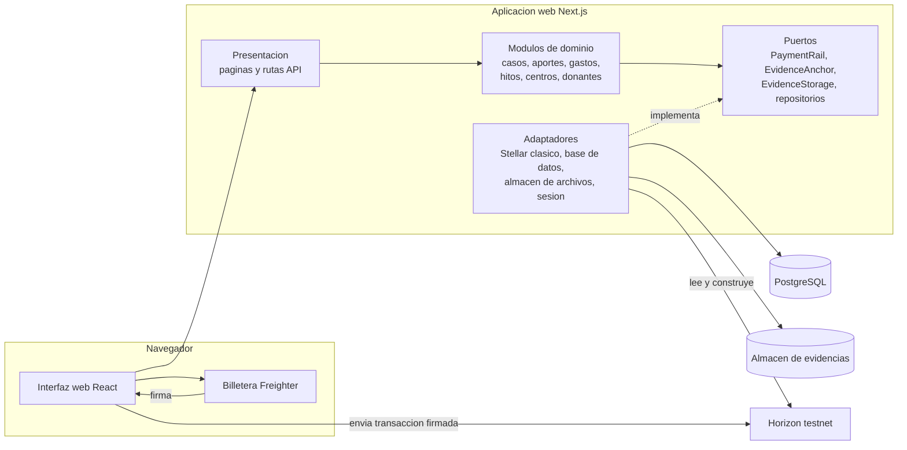
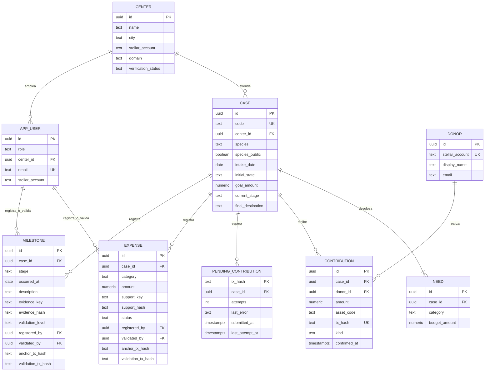
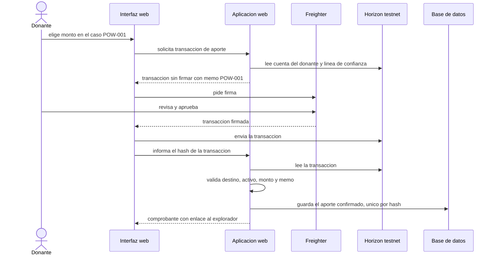
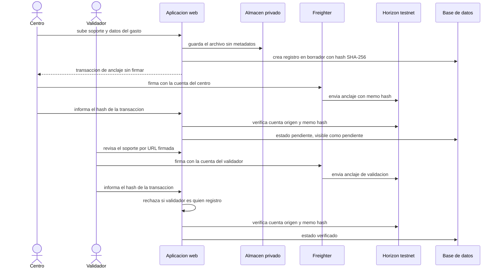
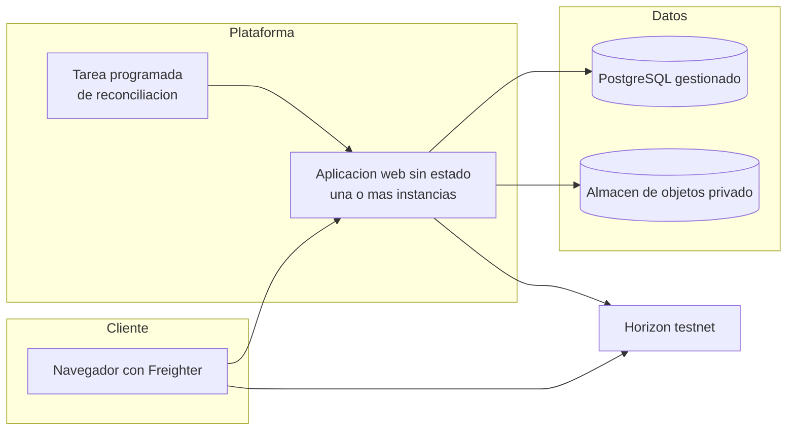

# Proof of Wild · Arquitectura del MVP

Diseño obtenido con ADD 3.0 a partir de los drivers de [`contexto-y-drivers.md`](contexto-y-drivers.md). Vocabulario fijo: **módulo** es una unidad de código con una capacidad de negocio (`modules/cases`); **adaptador** implementa un puerto contra un sistema externo (`platform/stellar`); **puerto** es una interfaz que el dominio necesita (`ports/`).

## 1. Resumen

Proof of Wild es un **monolito modular en capas con puertos y adaptadores**. Una sola aplicación web sirve la interfaz pública, el portal de centros y validadores y la API. Cada capacidad es un módulo de dominio con reglas puras; todo lo que toca la red Stellar, el almacén de archivos o la base de datos entra por un puerto. Las páginas públicas leen siempre de la base de datos; la red Stellar se consulta solo para confirmar escrituras.

Tres ideas sostienen el diseño:

1. **La red es la fuente de verdad de pagos y hashes; la base de datos es el modelo de lectura.** Un aporte existe para la plataforma solo después de que el servidor lo lee en Horizon (RN-03).
2. **Nadie custodia llaves.** Los aportes van directo a la cuenta Stellar verificada del centro y los registros de hash los firman con su billetera quien registra y quien valida. El servidor no guarda ninguna llave secreta.
3. **Lo privado nunca cruza la frontera pública.** Las respuestas públicas se construyen con una proyección explícita; los soportes están en un almacén privado y las imágenes se limpian de metadatos al subirlas.

## 2. Decisiones (ADR)

| ID | Decisión | Drivers | Alternativas descartadas | Costo |
|---|---|---|---|---|
| ADR-01 | Monolito modular en capas con puertos y adaptadores | QA-DEP-01, QA-TST-01, QA-MOD-01, CON-06 | Solo frontend; servicio de base de datos gestionado; microservicios | Más trabajo inicial que las dos primeras; escala como una sola unidad |
| ADR-02 | Next.js (App Router) con TypeScript y Tailwind; PostgreSQL con Drizzle ORM | QA-RND-01, RF-COM-01, QA-DEP-01 | SPA pura; Astro; Prisma | El comprobante necesita renderizado en servidor para que se vea al compartirlo; Drizzle es más ligero pero menos «mágico» que Prisma |
| ADR-03 | Aporte único como pago en el activo de prueba tipo USDC, directo a la cuenta Stellar del centro, con memo de texto igual al código del caso | RF-APA-01, QA-USA-01, CON-02 | Contrato por caso; una cuenta Stellar por caso | Sin reglas de desembolso en cadena (llegan en la etapa 2). El saldo disponible lo calcula la plataforma, no la red |
| ADR-04 | El servidor confirma cada aporte leyendo la transacción en Horizon (destino, activo, monto, memo); es idempotente por hash y una tarea de reconciliación reintenta los pendientes | RN-03, QA-TRZ-01, QA-DIS-01 | Confiar en el hash que envía el navegador; suscripción permanente a flujos de pagos | Consistencia eventual de hasta unos minutos si la red falla |
| ADR-05 | Anclaje de evidencia: el hash SHA-256 del soporte va en el memo hash de una transacción de anclaje (pago mínimo a sí mismo) firmada por la billetera del centro; la validación repite el anclaje firmada por la billetera del validador | RF-GAS-01, RF-HIT-01, RF-VAL-01, QA-TRZ-01, QA-SEG-02 | Cuenta de registro del servidor con llave secreta; evento de contrato Soroban | Centros y validadores necesitan billetera y cuenta de testnet; más fricción que un servicio central |
| ADR-06 | Las rutas públicas leen solo de la base de datos; si Horizon falla, se sirven los datos confirmados con aviso de sincronización | QA-RND-01, QA-DIS-01 | Consultar la red en cada visita | Los datos pueden estar atrasados por minutos |
| ADR-07 | Proyección pública separada del modelo interno; almacén privado de evidencias con acceso por URL firmada de corta vida; limpieza de EXIF al subir | QA-SEG-01, RN-06, RN-07, RN-08 | Servir las evidencias directamente; confiar en que el centro limpie las fotos | Una capa más de mapeo; procesamiento de imagen en el servidor |
| ADR-08 | Donantes identificados por su billetera, sin cuenta ni contraseña, solo ven datos públicos. Centros, validadores y administradores inician sesión; la autorización por rol se aplica en el servidor y la separación de funciones se refuerza con una restricción de base de datos | QA-SEG-02, RN-01, RN-02 | Autorización solo en la interfaz; cuentas para donantes en el MVP | La autenticación del MVP es mínima; se encapsula en un puerto para cambiarla por un proveedor gestionado |
| ADR-09 | `PaymentRail` y `EvidenceAnchor` como puertos; el adaptador Stellar clásico los implementa. En la etapa 2 un adaptador Soroban, basado en el contrato `RaizSilvestre` del equipo, implementa los mismos puertos | QA-MOD-01, CON-07 | Llamar al SDK de Stellar desde los módulos | Una indirección adicional |
| ADR-10 | Una aplicación sin estado, PostgreSQL gestionado y almacén de objetos privado; migraciones versionadas, semillas de los 3 casos ficticios y CI de tipos, pruebas y build | QA-DEP-01, CON-06 | Despliegue manual; contenedores orquestados | Dependencia de servicios gestionados para la demo |

### Tecnologías

| Capa | Elección |
|---|---|
| Aplicación | Next.js 16 (App Router), React 19, TypeScript 5, Tailwind CSS 4 |
| Datos | PostgreSQL 16, Drizzle ORM y drizzle-kit (migraciones SQL versionadas) |
| Stellar | `@stellar/stellar-sdk` (Horizon, construcción de transacciones), `@stellar/freighter-api` (billetera en el navegador) |
| Validación | zod para entradas de API y variables de entorno |
| Imágenes | sharp (re-codifica y elimina EXIF) |
| Pruebas | Vitest |
| Local | Docker Compose con PostgreSQL; almacén de evidencias en disco |

## 3. Iteraciones de diseño (ADD)

### Iteración 1 · Estructura general

Drivers: CON-06, QA-DEP-01, QA-TST-01, QA-MOD-01, QA-SEG-02.

| Alternativa | Plazo de una semana | Reglas de rol y datos privados (QA-SEG) | Testabilidad | Cambio a contrato en etapa 2 | Veredicto |
|---|---|---|---|---|---|
| A. Solo frontend con JSON y lectura de la red | Mejor | No cumple: sin servidor no se pueden hacer cumplir roles ni guardar privados; lo registrado se pierde al recargar | Parcial | Parcial | Descartada |
| B. Frontend con servicio de base de datos gestionado | Muy bueno | Parcial: reglas de acceso en configuración difíciles de probar; la limpieza de imágenes requiere funciones adicionales | Parcial | Parcial: acoplamiento al proveedor | Descartada |
| C. Monolito modular con backend propio | Bueno | Cumple | Cumple | Cumple (puertos) | **Elegida** |
| D. Servicios separados | Malo | Cumple | Cumple | Cumple | Descartada: sin driver de escalabilidad que lo justifique |

Trade-off aceptado: más trabajo que A y B. Se compensa con la estructura de carpetas ya definida, el orden de construcción del brief y la ausencia de un servicio extra que operar.

### Iteración 2 · Funcionalidad primaria: apadrinar

Drivers: RF-APA-01/02, RF-COM-01, QA-USA-01, RN-03.

- El servidor construye la transacción sin firmar, la billetera la firma y el navegador la envía a Horizon; después informa el hash al servidor. El servidor **no confía** en el navegador: lee la transacción y comprueba destino, activo, monto y memo (ADR-04).
- `contributions.tx_hash` es único: confirmar dos veces no duplica el aporte.
- Si la cuenta del donante no tiene la línea de confianza del activo, el flujo la agrega en la misma transacción.
- El comprobante se identifica por el hash de la transacción y se renderiza en servidor con metadatos para compartir en redes.

### Iteración 3 · Trazabilidad e integridad

Drivers: QA-TRZ-01, RF-GAS-01, RF-HIT-01, RF-VAL-01.

- El hash de evidencia es SHA-256 del archivo de soporte; si el hito no tiene archivo, es SHA-256 del JSON canónico del registro.
- Estados de un gasto: `borrador` (subido, sin ancla) → `pendiente` (anclado por el centro) → `verificado` (anclado por un validador) o `rechazado`. Solo `pendiente` y `verificado` son públicos (RN-01).
- Niveles de validación de un hito: presentado por el centro, revisado por un profesional, verificado de forma independiente (este último llega después del MVP).
- El servidor verifica cada ancla leyendo la transacción: cuenta origen igual a la cuenta registrada del centro o del validador, y memo hash igual al hash guardado.

### Iteración 4 · Seguridad y privacidad

Drivers: QA-SEG-01, QA-SEG-02, RN-04 a RN-08.

| Táctica | Dónde se aplica |
|---|---|
| Limit exposure | Proyección pública explícita (`toPublic…`) por módulo; los modelos internos nunca se serializan directamente |
| Separate entities | Almacén de evidencias privado; datos personales solo en la base de datos |
| Validate input | zod en cada ruta de API; el memo se valida a 28 bytes antes de construir la transacción |
| Authenticate y authorize actors | Sesión para centros, validadores y administradores; verificación de rol en el servidor en cada operación |
| Limit access | URLs firmadas de corta vida para soportes privados |
| Audit y nonrepudiation | Tabla `audit_log`; las firmas de centro y validador quedan en la red |
| Encrypt data | TLS en tránsito; cifrado en reposo del proveedor |

Decisión de menor superficie: el servidor del MVP **no guarda llaves secretas de Stellar**. Las cuentas de demo se fondean fuera de la aplicación y cada persona firma con su billetera.

### Iteración 5 · Resiliencia

Drivers: QA-DIS-01, QA-RND-01.

- Lectura desde la base de datos (ADR-06). La red solo está en la ruta de escritura.
- Adaptador Stellar con tiempo máximo de espera, reintentos con espera creciente y un corte de circuito simple.
- Los aportes enviados pero no confirmados se guardan en `pending_contributions`; una tarea programada llama a `/api/jobs/reconcile` y los reintenta. Si la red demuestra que no cumplen, se descartan.
- Aviso «última sincronización hace N minutos» cuando hay pendientes antiguos.

### Iteración 6 · Modificabilidad hacia la etapa 2

Drivers: QA-MOD-01, CON-07.

- Los módulos solo conocen `PaymentRail` y `EvidenceAnchor`. El adaptador Soroban reemplaza al clásico y asociará aportes a casos, aplicará permisos, emitirá eventos y exigirá dos firmas para desembolsar, tomando como base el contrato `RaizSilvestre` ya probado.
- Cambia la unidad de custodia (de la cuenta del centro al contrato), no los módulos de dominio.

## 4. Vistas

### 4.1 Contexto

Ver el diagrama de contexto en [`contexto-y-drivers.md`](contexto-y-drivers.md#2-actores-y-sistemas-externos).

### 4.2 Contenedores y componentes



| Elemento | Responsabilidad | Interfaz principal |
|---|---|---|
| Presentación (`app/`) | Páginas públicas, portal privado, rutas API, validación de entrada | HTTP |
| `modules/cases` | Casos, necesidades, progreso de financiación, proyección pública | `listPublicCases`, `getPublicCase` |
| `modules/contributions` | Aportes, confirmación contra la red, comprobante | `prepareContribution`, `confirmContribution` |
| `modules/expenses` | Gastos, estados y validación | `registerExpense`, `anchorExpense`, `validateExpense` |
| `modules/milestones` | Hitos, línea de tiempo y niveles de validación | `registerMilestone`, `validateMilestone` |
| `modules/centers` | Centros, cuenta Stellar verificada, perfil | `getPublicCenter` |
| `modules/donors` | Donantes por billetera, panel | `getDonorPanel` |
| `ports/` | Contratos de lo que el dominio necesita del exterior | TypeScript |
| `platform/stellar` | Adaptador Horizon: construye transacciones, lee y verifica pagos y anclas | `PaymentRail`, `EvidenceAnchor` |
| `platform/db` | Esquema, migraciones, repositorios, semillas | Repositorios |
| `platform/storage` | Almacén privado, URLs firmadas, limpieza de imágenes | `EvidenceStorage` |
| `platform/auth` | Sesión y roles | `getSession`, `requireRole` |

### 4.3 Modelo de datos

Todo vive en la base de datos; en Stellar solo van pagos y hashes. Los montos usan 7 decimales, como Stellar.



`contributions` solo contiene aportes que el servidor ya leyó en la red (`confirmed_at` es la fecha de la transacción). Los envíos que la red aún no muestra, o que no se pudieron leer, esperan en `pending_contributions` hasta que la reconciliación los confirme.

Restricciones que la base de datos hace cumplir: `contributions.tx_hash` único, `CHECK (registered_by <> validated_by)` en gastos e hitos (RN-02), y estados de gasto restringidos a un conjunto cerrado. Además existe `audit_log` (actor, acción, entidad, fecha, datos).

### 4.4 Flujo de apadrinamiento



### 4.5 Flujo de registro y validación de un gasto o hito



### 4.6 Despliegue conceptual



La aplicación no guarda estado local, así que puede replicarse. Las migraciones y las semillas de los 3 casos ficticios se ejecutan con un comando antes de arrancar.

## 5. Estructura del repositorio y reglas de dependencia

```text
src/
  app/            Presentación (Next.js): páginas, layouts y rutas API
  components/     Componentes de interfaz reutilizables
  modules/        Dominio y aplicación, un directorio por capacidad
    <modulo>/     domain.ts (reglas puras) · service.ts (casos de uso) ·
                  repository.ts (puerto de persistencia) · index.ts (API pública)
  ports/          Puertos compartidos: PaymentRail, EvidenceAnchor, EvidenceStorage
  platform/       Adaptadores y configuración
    db/  stellar/  storage/  auth/  config/  container.ts (raíz de composición)
  lib/            Utilidades sin lógica de negocio
docs/arquitectura/  Contexto, drivers y arquitectura
tests/            Pruebas de reglas de dominio y de adaptadores
```

| Regla | Qué impide |
|---|---|
| `modules/` importa solo de `ports/` y `lib/` | Que el dominio dependa de Stellar, de la base de datos o de Next.js |
| `platform/` implementa `ports/` y no importa `modules/` | Dependencias circulares |
| Solo `platform/container.ts` conoce módulos y adaptadores a la vez | Que el cableado se disperse |
| `app/` usa módulos solo por su `index.ts` | Que la presentación llame a repositorios directamente |

## 6. Trazabilidad

| Driver | Escenario | Decisión | Elementos | Vista | Evidencia prevista |
|---|---|---|---|---|---|
| Promesa del producto | QA-TRZ-01 | ADR-04, ADR-05 | `contributions`, `expenses`, `milestones`, `platform/stellar` | 4.4, 4.5 | Prueba de verificación con transacciones de testnet |
| Datos sensibles | QA-SEG-01 | ADR-07 | proyecciones públicas, `platform/storage` | 4.2, 4.3 | Prueba de contrato de la API pública; prueba de EXIF |
| Regla clave | QA-SEG-02 | ADR-08 | `modules/expenses`, `modules/milestones`, restricción `CHECK` | 4.3, 4.5 | Pruebas de dominio y de base de datos |
| Demo en red pública | QA-DIS-01 | ADR-04, ADR-06 | lectura desde base de datos, reconciliación | 4.6 | Prueba con adaptador simulado caído |
| Etapa 2 | QA-MOD-01 | ADR-09 | `ports/`, `platform/stellar` | 4.2 | Segundo adaptador sin cambios en `modules/` |
| Velocidad | QA-TST-01, QA-DEP-01 | ADR-01, ADR-10 | `modules/*/domain.ts`, CI, semillas | 5 | Suite de dominio sin red y CI en verde |

## 7. Evaluación ligera (ATAM reducido)

Evaluación hecha por el propio equipo con escenarios y riesgos; no sustituye un ATAM con evaluadores externos.

### Árbol de utilidad

| Atributo | Escenario hoja | (Importancia, Dificultad) |
|---|---|---|
| Trazabilidad | QA-TRZ-01 | (A, M) |
| Seguridad | QA-SEG-01 | (A, M) |
| Seguridad | QA-SEG-02 | (A, B) |
| Disponibilidad | QA-DIS-01 | (A, M) |
| Usabilidad | QA-USA-01 | (A, M) |
| Modificabilidad | QA-MOD-01 | (M, A) |

### Riesgos

| ID | Riesgo | Causa (decisión) | Mitigación |
|---|---|---|---|
| R-01 | Centros y validadores deben instalar una billetera y tener cuenta de testnet; el día de la demo puede fallar | ADR-05 | Cuentas de demo preparadas y probadas con anticipación; ensayo el jueves 12 |
| R-02 | La testnet se reinicia y los hashes guardados dejan de existir en la red | CON-01 | Guardar hashes en la base de datos, tarea de reconciliación, no depender de datos de testnet antiguos |
| R-03 | Autenticación mínima para centros y validadores | ADR-08 | Puerto de sesión; reemplazar por un proveedor gestionado antes de un piloto real |
| R-04 | El saldo disponible lo calcula la plataforma (aportes menos gastos verificados) y puede no coincidir con lo que hay en la cuenta del centro | ADR-03 | Mostrar el saldo como «declarado por el centro y verificado por la plataforma»; la custodia por contrato llega en la etapa 2 |
| R-05 | Alcance grande para una semana | CON-06 | Seguir el orden del brief: aporte completo, luego hitos y gastos, luego panel y perfil |
| R-06 | Un hash no prueba que la factura sea auténtica | RN-10 | Decirlo en la interfaz y en el pitch |

### Puntos de sensibilidad y trade-offs

| ID | Tipo | Descripción |
|---|---|---|
| S-01 | Sensibilidad | La frecuencia de reconciliación determina cuánto tarda en confirmarse un aporte tras una caída de la red (QA-DIS-01) |
| S-02 | Sensibilidad | El tamaño de las imágenes y su procesamiento en servidor afecta el tiempo de subida (QA-USA-01) |
| T-01 | Trade-off | Leer de la base de datos mejora rendimiento y resiliencia, pero introduce consistencia eventual frente a la red (QA-RND-01, QA-DIS-01 contra QA-TRZ-01) |
| T-02 | Trade-off | Anclajes firmados por billetera eliminan la custodia de llaves y dan no repudio, pero añaden fricción para centros y validadores (QA-SEG contra QA-USA) |
| T-03 | Trade-off | El monolito acelera el plazo y facilita probar, pero escala como una unidad (QA-DEP, QA-TST contra escalabilidad independiente) |

### No-riesgos

- La separación de funciones se aplica en el servidor y en la base de datos, no solo en la interfaz.
- Ningún dato personal ni ubicación se escribe en la red y el servidor no guarda llaves secretas.
- Confirmar un aporte es idempotente por hash de transacción.

### Deuda reconocida

Autenticación mínima, ausencia de cierre de caso y de reglas de reasignación de saldo, y desembolso sin segunda firma hasta la etapa 2.
