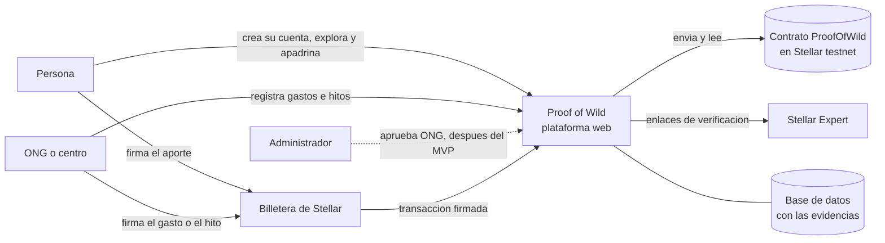

# Proof of Wild · Contexto y drivers arquitectónicos

Fuente de requisitos: *Proof of Wild — Brief técnico del MVP* (versión del 9 de noviembre de 2026) y el documento de datos de prueba. Este documento fija el propósito, los requisitos arquitectónicamente significativos (ASR) y los drivers que guían el diseño de [`arquitectura.md`](arquitectura.md). La columna «Estado» dice cómo está cada cosa en el código actual.

## 1. Propósito y alcance

**Propósito del diseño:** definir la arquitectura de una aplicación web donde una persona apadrina la recuperación de un animal silvestre rescatado y verifica, paso a paso, en qué se usó su aporte y qué avances logró. El dinero lo custodia un contrato en Soroban que lo reparte entre las etapas del tratamiento y le paga directo a los proveedores; el hash de cada factura y de cada evidencia queda en Stellar. Los documentos y los datos personales quedan fuera de la red.

**Alcance del MVP (presentación del 13 de noviembre de 2026).** Una demo de principio a fin: crear una cuenta, elegir un caso, apadrinarlo en testnet y ver el aporte, un gasto pagado al proveedor y un hito registrados en Stellar. Entran 5 casos ficticios de 2 ONG ficticias, en etapas distintas (recién ingresado, en rehabilitación, liberado o en santuario), con sus proveedores, donantes y voluntariados. Funciones congeladas el 11 de noviembre.

**Fuera del MVP:** registro y cierre de casos desde la interfaz (en la demo se cargan como datos de prueba), firma doble (ONG y validador) en el contrato, aprobación de ONG desde un panel, aportes mensuales, cuentas corporativas, rampa COP–USDC, recuperación de contraseña y filtros del catálogo.

**Modelo:** B2B2C. Los clientes son centros y ONG de rescate; los usuarios son personas que apadrinan o se inscriben como voluntarias.

## 2. Actores y sistemas externos

| Actor | Qué hace | Acceso |
|---|---|---|
| Persona (donante y voluntaria) | Explora casos, apadrina, sigue la ruta y la línea de tiempo, comparte su comprobante y su huella, se inscribe a voluntariados | Sitio público; cuenta de persona para apadrinar e inscribirse; su billetera para firmar |
| ONG o centro | Pide su registro, muestra su perfil, registra gastos con factura e hitos con foto | Cuenta de ONG; portal privado cuando la ONG está aprobada |
| Validador | Profesional (veterinario o biólogo) que revisa y firma cada gasto o hito | Etapa 2. En el MVP el nivel de validación lo fija la ONG |
| Administrador | Aprueba ONG y revisa reportes | Cuenta creada por la semilla; el panel queda para después del MVP |
| Empresa | Patrocina varios casos y recibe un reporte de impacto | Después del MVP |

| Sistema externo | Uso |
|---|---|
| Billeteras de Stellar (Freighter, Albedo, xBull, Lobstr, Hana, Rabet) vía Stellar Wallets Kit | Firman los aportes y los registros de gasto e hito en el navegador |
| Red Stellar testnet: RPC de Soroban y Horizon | Fuente de verdad del dinero, los repartos y los hashes |
| Contrato `ProofOfWild` y el Stellar Asset Contract del USDC de prueba | Custodia, reparto por etapas y pago a proveedores |
| Friendbot | Fondea cuentas de prueba (solo en los scripts) |
| Stellar Expert | Destino de los enlaces de verificación |
| Vercel y Neon | Hospedan la aplicación y la base de datos con las evidencias |
| Después del MVP: `stellar.toml` (SEP-1) de cada centro, ancla COP–USDC (SEP-24), banco | Identidad del centro, aportes en pesos, donaciones de empresas |

*Diagrama de contexto: la plataforma está en el centro y no muestra componentes internos.*

## 3. Requisitos funcionales

Prioridad según el brief: **M** entra en el MVP; **D** queda para después.

| ID | Requisito | Prio. | Estado |
|---|---|---|---|
| RF-INI-01 | Página principal con Inicio, Cómo funciona, Casos y Voluntariados | M | Construido como una sola página con menú de anclas |
| RF-CAT-01 | Catálogo: tarjetas con especie (si es seguro divulgarla), ONG, meta, porcentaje cubierto y etapa actual | M | Construido; cada tarjeta muestra la ruta de etapas |
| RF-CAT-02 | Detalle del caso: estado inicial, meta y etapas, línea de tiempo con evidencia y nivel de validación, y panel de transparencia (aportes, gastos, saldo, cada uno con enlace a su transacción) | M | Construido |
| RF-CUE-01 | Crear cuenta de persona u ONG e ingresar con correo y contraseña | M | Construido (SRP-6a) |
| RF-CUE-02 | Registro de ONG como solicitud en revisión | M | Construido |
| RF-APA-01 | Apadrinar: con la sesión de persona iniciada, elegir monto (aporte único), conectar la billetera en testnet y firmar `aportar` en el contrato; ver antes cómo se repartirá entre las etapas | M | Construido |
| RF-APA-02 | Confirmar el aporte leyendo la transacción en la red y registrarlo con el reparto del contrato | M | Construido |
| RF-APA-03 | Quien no tiene cuenta recibe una invitación a crearla o ingresar y vuelve al caso con la ventana de apadrinar abierta | M | Construido (ADR-16) |
| RF-COM-01 | Comprobante: monto, caso, fecha, reparto, enlace a la transacción y botón para compartir | M | Construido |
| RF-PAN-01 | Mi perfil: casos apadrinados con lo aportado por etapa, insignia «Huella verificada» y página pública de la huella | M | Construido |
| RF-CEN-01 | Perfil público de la ONG: quién es, cuenta Stellar, casos, gastos y resultados | M | Construido |
| RF-GAS-01 | Registrar gasto: etapa, proveedor, monto y factura; el contrato paga al proveedor y guarda el hash de la factura | M | Construido |
| RF-HIT-01 | Registrar hito: etapa, descripción y foto; el hash queda en el contrato | M | Construido |
| RF-VOL-01 | Voluntariados de las ONG con inscripción de personas | M | Construido |
| RF-KYC-01 | Verificación de identidad de la persona por niveles: documento, prueba de vida y comparación del rostro; exigida para aportes de más de 50 USDC | Puntos adicionales | Construido; biometría real en el navegador, registro simulado (ADR-21) |
| RF-KYB-01 | Verificación de la ONG (registro legal, representante legal y cuenta Stellar) visible en su perfil | Puntos adicionales | Simulada en la demo (ADR-21) |
| RF-VAL-01 | Validar un gasto o un hito con la firma de un validador distinto de quien lo registró | M | Diferido a la etapa 2; el MVP muestra el nivel de validación |
| RF-CAS-01 | Registrar caso desde el portal | D | Fuera del MVP |
| RF-CAS-02 | Cerrar caso: destino final y manejo del saldo | D | Fuera del MVP |
| RF-ADM-01 | Aprobar ONG y revisar reportes | D | Fuera del MVP (la semilla deja las ONG de la demo aprobadas) |
| RF-EMP-01 | Cuenta corporativa y reporte de impacto | D | Fuera del MVP |

## 4. Restricciones

| ID | Restricción |
|---|---|
| CON-01 | Stellar testnet; billeteras compatibles con Stellar Wallets Kit; un activo de prueba que representa USDC, con su Stellar Asset Contract; sin token propio |
| CON-02 | En el contrato el código del caso es un `Symbol` de Soroban (`POW_001`) y cada hash ocupa 32 bytes (SHA-256) |
| CON-03 | En la red solo van montos, cuentas, códigos de caso y hashes. Lo escrito en Stellar es público y no se puede borrar |
| CON-04 | Documentos, fotos y datos personales viven en la base de datos |
| CON-05 | Los datos de las personas se tratan conforme a la Ley 1581 de 2012 |
| CON-06 | Plazo: demo el 13 de noviembre de 2026, funciones congeladas el 11 de noviembre; equipo técnico reducido |
| CON-07 | El pago directo debía poder reemplazarse por un contrato Soroban. Cumplida en el MVP: el brief del 9 de noviembre pidió el contrato y se hizo cambiando el adaptador (ADR-11) |

## 5. Reglas de negocio que el producto debe hacer cumplir

Estas reglas deben estar en el producto, no solo en un manual.

| ID | Regla | Cómo se cumple hoy |
|---|---|---|
| RN-01 | Lo que no está confirmado en la red nunca se muestra como confirmado | Las páginas públicas solo leen aportes, gastos e hitos `confirmada`; cada gasto e hito muestra su nivel de validación |
| RN-02 | Quien registra un gasto o un hito no puede validarlo | Diferida con el rol de validador (etapa 2) |
| RN-03 | Un aporte se confirma solo leyendo la transacción en la red, nunca por lo que informa el navegador | ADR-12 |
| RN-04 | Ningún dato personal ni ubicación va en la red | El contrato solo recibe montos, cuentas, códigos y hashes |
| RN-05 | Apadrinar es «seguir el caso». Los casos se identifican por código y especie, sin nombres tiernos; la especie se muestra solo cuando es seguro | Código `POW_000` con restricción en la base; `species_public` por caso |
| RN-06 | Fotos del animal solo, sin personas; se borran los metadatos (EXIF) al subirlas | sharp re-codifica en WebP sin metadatos al subir y en `preparar-imagenes` |
| RN-07 | Nunca se publican ubicaciones exactas del centro, de los recintos ni de los sitios de liberación | El modelo solo guarda la ciudad de la ONG, del proveedor y del voluntariado; ninguna dirección ni coordenada |
| RN-08 | Los informes completos y los datos de terceros son privados | Las facturas se publican ya anonimizadas para que su hash se pueda comparar (ADR-13) |
| RN-09 | La reubicación o el santuario se presentan como destinos legítimos, no como fracaso | Textos de resultado del caso |
| RN-10 | La red prueba que hubo un pago y que un documento no cambió; no prueba que la factura sea auténtica | Se dice en la interfaz (niveles de validación) y en el pitch |
| RN-11 | Solo una persona con cuenta puede apadrinar; las ONG y el administrador no aportan | El servidor responde 401 sin sesión y 403 con otra cuenta (ADR-16) |
| RN-12 | Un aporte de más de 50 USDC exige identidad verificada; la biometría es opcional por debajo del límite y exige autorización expresa (dato sensible) | El servidor responde 403 `verification_required`; se guarda solo el resultado y la persona puede borrarlo (ADR-21) |
| RN-13 | Un documento verifica una sola cuenta | HMAC del documento con restricción única en la base |

## 6. Atributos de calidad como escenarios

| ID | Fuente | Estímulo | Artefacto | Entorno | Respuesta | Medida |
|---|---|---|---|---|---|---|
| QA-TRZ-01 Trazabilidad e integridad | Persona o visitante | Abre el panel de transparencia y verifica un aporte, gasto o hito | Panel de transparencia, evidencias públicas y contrato | Operación normal, testnet disponible | Muestra el enlace a la transacción y la evidencia publicada, cuyo hash coincide con el guardado en el contrato | 100 % de los ítems confirmados tienen transacción resoluble y hash coincidente (comprobado por `red:probar`) |
| QA-SEG-01 Privacidad | Visitante anónimo o atacante | Pide datos de un caso, ONG o persona, o descarga una imagen | Páginas públicas, evidencias y transacciones | Operación normal | Entrega solo la proyección pública, sin ubicaciones exactas, datos personales ni identificadores internos | 0 campos privados en respuestas públicas (prueba automática); 100 % de imágenes sin EXIF; 0 datos personales en transacciones |
| QA-SEG-02 Roles | Visitante sin cuenta, persona, ONG | Intenta apadrinar sin cuenta de persona, entrar al portal sin ser ONG aprobada u operar un caso de otra ONG | Rutas de aportes, portal y servicios de registros | Operación normal | Rechaza la operación en el servidor; si es apadrinar, ofrece crear la cuenta o ingresar | 100 % de intentos rechazados (401 o 403). La separación registrador y validador llega en la etapa 2 |
| QA-DIS-01 Resiliencia ante la red | RPC de Soroban | No responde o tarda durante la demo | Adaptador del contrato | Demo en curso | Las páginas siguen sirviendo lo confirmado desde la base; un aporte enviado queda `enviada` y se vuelve a consultar | 100 % de páginas de lectura responden; ningún aporte firmado se pierde (copia antes de enviar) |
| QA-RND-01 Rendimiento percibido | Persona en móvil con 4G | Abre la página principal y el detalle del caso | Páginas públicas | Hasta 50 casos y 100 visitas simultáneas | Renderiza desde la base, sin consultar la red en la ruta de lectura, con pantallas de carga | LCP ≤ 2,5 s (p75); respuesta del servidor ≤ 500 ms (p95), sin contar el arranque en frío |
| QA-USA-01 Usabilidad | Persona nueva con una billetera instalada | Apadrina un caso | Invitación de cuenta y ventana de apadrinar | Operación normal | Crea su cuenta, vuelve al caso con la ventana abierta, elige monto, conecta, firma y ve el comprobante | ≤ 5 pasos y ≤ 3 min, sin tener que buscar de nuevo el caso |
| QA-MOD-01 Modificabilidad | Equipo de desarrollo | Agregar la firma doble (ONG y validador) o cambiar el contrato | Contrato, adaptador Stellar y servicio de registros | Etapa 2 | Cambia el contrato y el adaptador del mismo puerto | Cambios confinados al contrato, `platform/stellar` y `modules/records`; pruebas de `modules/cases` sin cambios. El paso del pago con memo al contrato ya se hizo así |
| QA-TST-01 Testabilidad | Desarrollador | Ejecuta las pruebas de reglas de negocio | Módulos de dominio | Sin red ni base de datos | Corren de forma aislada | Reglas del dominio con prueba; suite en < 30 s |
| QA-DEP-01 Desplegabilidad | Equipo | Despliega el MVP al entorno de demo | Aplicación, base de datos y red | Repositorio limpio | Migra, prepara la red y la base y arranca | `red:preparar` en minutos; CI en verde (tipos, pruebas, build); despliegue en Vercel al fusionar en `main` |

## 7. Priorización de drivers

Importancia para el negocio y dificultad arquitectónica (A/M/B). Los (A, A) y (A, M) se analizan primero.

| Escenario | Importancia | Dificultad | Por qué |
|---|---|---|---|
| QA-TRZ-01 | A | M | Es la promesa del producto |
| QA-SEG-01 | A | M | Lo publicado en la red no se puede borrar; hay datos de fauna y de personas |
| QA-SEG-02 | A | B | Cada aporte queda ligado a una persona y cada gasto a su ONG |
| QA-DIS-01 | A | M | La demo depende de una red pública de pruebas |
| QA-USA-01 | A | M | La persona nueva debe llegar al comprobante sin ayuda, aun con el paso de la cuenta |
| QA-MOD-01 | M | A | Condiciona la firma doble de la etapa 2 |
| QA-RND-01 | M | B | Se resuelve por diseño al leer de la base de datos |
| QA-TST-01 | M | B | Habilita construir rápido y con seguridad |
| QA-DEP-01 | M | B | Reduce el riesgo del plazo |

## 8. Decisiones abiertas del brief y cómo se resolvieron

| Decisión del brief | Resolución | ADR |
|---|---|---|
| Cómo se asocia un aporte a un caso | El contrato `ProofOfWild` recibe el aporte con el código del caso y lo reparte entre sus etapas. Reemplazó al memo de texto del primer diseño (ADR-03) | ADR-11 |
| Cómo se guardan los datos y si hay servidor | Aplicación con backend propio (monolito modular), PostgreSQL y evidencias en la base | ADR-01, ADR-02, ADR-17 |
| Si donar exige cuenta | Sí: apadrinar exige una cuenta de persona, con invitación y regreso al caso | ADR-14, ADR-16 |
| Si se verifica la identidad (KYC) | Por niveles: identidad verificada solo para aportes de más de 50 USDC, con biometría en el navegador y registro simulado | ADR-21 |
| Quién prepara los casos de la demo | Un script reproducible prepara la red y la base con los 5 casos del documento de datos de prueba | ADR-15 |

Quedan para después del 13 de noviembre: modelo de ingresos, aportes mensuales, reasignación de saldo si el animal muere o el caso supera su meta, la firma de un validador y con qué centro validar el flujo.

## 9. Supuestos y límites conocidos

- Hasta ahora solo se entrevistó a donantes (4 según el brief). Ningún centro ha sido entrevistado, así que las reglas de registro y validación son una hipótesis.
- La testnet de Stellar se reinicia periódicamente (el próximo reinicio anunciado es el 16 de diciembre de 2026) y lo hecho en ella no se puede deshacer: antes de la demo se vuelve a correr `npm run red:preparar` para tener un contrato con los casos en su estado inicial.
- Un hash prueba existencia e integridad de un documento, no su veracidad (RN-10).
