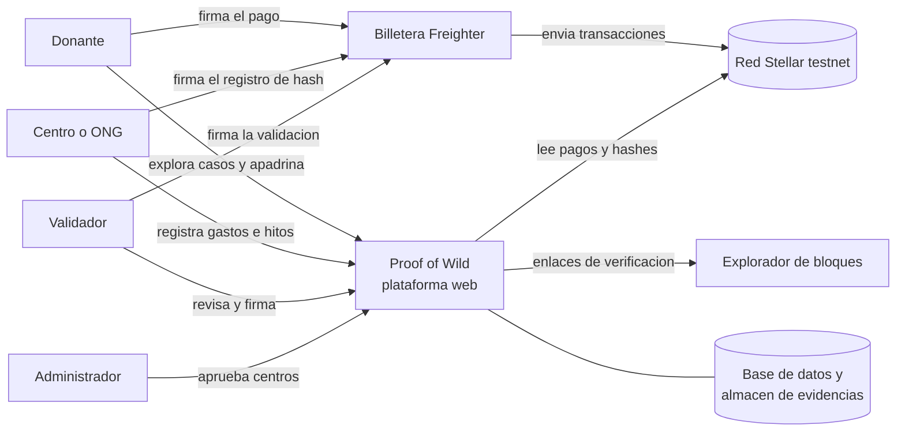

# Proof of Wild · Contexto y drivers arquitectónicos

Fuente de requisitos: *Proof of Wild — Brief técnico del MVP* (versión consolidada más reciente). Este documento fija el propósito, los requisitos arquitectónicamente significativos (ASR) y los drivers que guían el diseño de [`arquitectura.md`](arquitectura.md).

## 1. Propósito y alcance

**Propósito del diseño:** definir la arquitectura de una aplicación web donde una persona apadrina la recuperación de un animal silvestre rescatado y verifica, paso a paso, en qué se usó su aporte y qué avances logró. Los pagos y la huella (hash) de cada evidencia quedan en Stellar; los documentos y los datos personales quedan fuera de la red.

**Alcance del MVP (presentación del 13 de noviembre de 2026).** Una demo de principio a fin: elegir un caso, apadrinarlo en testnet y ver el aporte y un hito registrados en Stellar. Entran 3 casos ficticios de un centro ficticio, en etapas distintas (recién ingresado, en rehabilitación, liberado o en santuario). Se sugiere congelar funciones el 11 de noviembre.

**Fuera del MVP:** registro de casos desde la interfaz (en la demo se cargan como datos de prueba), cierre de casos, contrato inteligente con desembolso a dos firmas, aportes mensuales, cuentas corporativas, rampa COP–USDC y filtros del catálogo.

**Modelo:** B2B2C. Los clientes son centros y ONG de rescate; los usuarios son donantes individuales.

## 2. Actores y sistemas externos

| Actor | Qué hace | Acceso |
|---|---|---|
| Donante | Explora casos, apadrina, sigue la línea de tiempo, descarga y comparte su comprobante | Público + su billetera |
| Centro o ONG | Registra gastos con soporte e hitos de recuperación | Portal privado |
| Validador | Profesional del centro (veterinario o biólogo) que revisa y firma cada gasto o hito | Portal privado, permiso de firma |
| Administrador | Aprueba centros y revisa reportes | Panel interno |
| Empresa | Patrocina varios casos y recibe un reporte de impacto | Después del MVP |

| Sistema externo | Uso |
|---|---|
| Billetera Freighter | Firma los pagos y los registros de hash en el navegador |
| Red Stellar (testnet) vía Horizon | Fuente de verdad de pagos y hashes |
| Friendbot | Fondea cuentas de prueba |
| Explorador de bloques (Stellar Expert) | Destino de los enlaces de verificación |
| Almacén de evidencias y base de datos | Documentos, fotos y datos de dominio, fuera de la red |
| Después del MVP: `stellar.toml` (SEP-1) de cada centro, ancla COP–USDC (SEP-24), banco | Identidad del centro, aportes en pesos, donaciones de empresas |

*Diagrama de contexto: la plataforma está en el centro y no muestra componentes internos.*

## 3. Requisitos funcionales

Prioridad según el brief: **M** entra en el MVP; **D** queda para después.

| ID | Requisito | Prio. |
|---|---|---|
| RF-CAT-01 | Catálogo: tarjetas con especie (si es seguro divulgarla), centro, meta, porcentaje recaudado y etapa actual | M |
| RF-CAT-02 | Detalle del caso: estado inicial, meta y desglose de necesidades, línea de tiempo con evidencia y validador, y panel de transparencia (aportes, gastos respaldados, gastos pendientes, saldo disponible, cada uno con enlace a su transacción) | M |
| RF-APA-01 | Apadrinar: elegir monto (aporte único), conectar la billetera en testnet, confirmar y firmar el pago con el código del caso en el memo | M |
| RF-APA-02 | Confirmar el aporte leyendo la transacción en la red y registrarlo | M |
| RF-COM-01 | Comprobante: monto, caso, fecha, enlace a la transacción y botón para compartir | M |
| RF-PAN-01 | Mi panel: casos apadrinados por la billetera conectada, últimas actualizaciones y comprobantes | M |
| RF-CEN-01 | Perfil del centro verificado: quién es, cuenta Stellar, casos atendidos, gastos y resultados históricos | M |
| RF-GAS-01 | Registrar gasto: monto, categoría, soporte y caso; el hash del soporte queda en la red | M |
| RF-HIT-01 | Registrar hito: etapa, descripción, evidencia y validador; el hash queda en la red | M |
| RF-VAL-01 | Validar un gasto o un hito con la firma de un validador distinto de quien lo registró | M |
| RF-INI-01 | Página de inicio (puede ser el propio catálogo) | Si sobra tiempo |
| RF-CAS-01 | Registrar caso desde el portal | D |
| RF-CAS-02 | Cerrar caso: destino final y manejo del saldo | D |
| RF-ADM-01 | Aprobar centros y revisar reportes | D |
| RF-EMP-01 | Cuenta corporativa y reporte de impacto | D |

## 4. Restricciones

| ID | Restricción |
|---|---|
| CON-01 | Stellar testnet; billetera Freighter; un activo de prueba que representa USDC; sin token propio |
| CON-02 | El memo de texto de una transacción admite hasta 28 bytes; un memo de hash, 32 bytes (SHA-256) |
| CON-03 | En la red solo van pagos y hashes. Lo escrito en Stellar es público y no se puede borrar |
| CON-04 | Documentos, fotos y datos personales viven en la base de datos y el almacén de evidencias |
| CON-05 | Los datos de los donantes se tratan conforme a la Ley 1581 de 2012 |
| CON-06 | Plazo: demo el 13 de noviembre de 2026, funciones congeladas el 11 de noviembre; equipo técnico reducido |
| CON-07 | Debe poder reemplazarse el pago directo por un contrato Soroban en la etapa 2 |

## 5. Reglas de negocio que el producto debe hacer cumplir

Estas reglas deben estar en el producto, no solo en un manual.

| ID | Regla |
|---|---|
| RN-01 | Un gasto sin validar se muestra como pendiente, nunca como confirmado |
| RN-02 | Quien registra un gasto o un hito no puede validarlo |
| RN-03 | Un aporte se confirma solo leyendo la transacción en la red, nunca por lo que informa el navegador |
| RN-04 | Ningún dato personal ni ubicación va en la red |
| RN-05 | Apadrinar es «seguir el caso». Los casos se identifican por código y especie, sin nombres tiernos; la especie se muestra solo cuando es seguro |
| RN-06 | Fotos y videos del animal solo, sin personas cargándolo o tocándolo; se borran los metadatos (EXIF) al subirlos |
| RN-07 | Nunca se publican ubicaciones exactas del centro, de los recintos ni de los sitios de liberación |
| RN-08 | Los informes veterinarios completos y las facturas con datos de terceros son privados; se publica un resumen y el hash |
| RN-09 | La reubicación o el santuario se presentan como destinos legítimos, no como fracaso |
| RN-10 | La red prueba que hubo un pago y que un documento no cambió; no prueba que la factura sea auténtica. Eso depende de la validación humana y debe decirse en la interfaz y en el pitch |

## 6. Atributos de calidad como escenarios

| ID | Fuente | Estímulo | Artefacto | Entorno | Respuesta | Medida |
|---|---|---|---|---|---|---|
| QA-TRZ-01 Trazabilidad e integridad | Donante o visitante | Abre el panel de transparencia y verifica un aporte, gasto o hito | Panel de transparencia y servicio de verificación | Operación normal, testnet disponible | Muestra el enlace a la transacción; el servidor comprueba que el hash del soporte guardado coincide con el de la red | 100 % de los ítems «verificado» tienen transacción resoluble y hash coincidente; 0 ítems verificados sin ancla |
| QA-SEG-01 Privacidad | Visitante anónimo o atacante | Pide datos de un caso, centro o donante, o descarga una imagen | API pública, almacén de evidencias, transacciones | Operación normal | Entrega solo la proyección pública, sin ubicaciones exactas, datos personales ni soportes completos | 0 campos privados en respuestas públicas (prueba automática); 100 % de imágenes sin EXIF; 0 datos personales en transacciones |
| QA-SEG-02 Separación de funciones | Usuario del centro | Intenta validar un registro propio, o validar sin permiso de firma | Servicios de gastos e hitos | Operación normal | Rechaza la operación y la deja en la auditoría | 100 % de intentos rechazados (HTTP 403) y auditados; la regla también está en la base de datos |
| QA-DIS-01 Resiliencia ante caída de la red | Servicio Horizon | No responde o devuelve 5xx durante 10 min o más | Adaptador Stellar | Demo en curso | Las páginas públicas siguen sirviendo datos ya confirmados con aviso de última sincronización; la confirmación de aportes nuevos queda pendiente y se reintenta | 100 % de páginas de lectura responden 200; ningún aporte pagado queda sin confirmar 15 min después de restablecida la red |
| QA-RND-01 Rendimiento percibido | Donante en móvil con 4G | Abre catálogo y detalle del caso | Páginas públicas | Operación normal, hasta 50 casos y 100 visitas simultáneas | Renderiza el contenido sin consultar la red Stellar en la ruta de lectura | LCP ≤ 2,5 s (p75); respuesta del servidor ≤ 500 ms (p95) |
| QA-USA-01 Usabilidad | Donante nuevo con Freighter instalada | Apadrina un caso | Flujo de apadrinamiento | Operación normal | Elige monto, conecta, firma y ve el comprobante | ≤ 4 pasos y ≤ 2 min |
| QA-MOD-01 Modificabilidad | Equipo de desarrollo | Reemplazar el pago directo por un contrato Soroban con desembolso por etapas | Adaptador Stellar y reglas de aportes | Etapa 2 | Implementa otro adaptador de los mismos puertos | Cambios confinados a `platform/stellar` y configuración (≤ 1 módulo); ≤ 5 días-persona; pruebas de dominio sin cambios |
| QA-TST-01 Testabilidad | Desarrollador | Ejecuta las pruebas de reglas de negocio | Módulos de dominio | Sin red ni base de datos | Corren de forma aislada | 100 % de las RN con prueba; suite en < 30 s |
| QA-DEP-01 Desplegabilidad | Equipo | Despliega el MVP al entorno de demo | Aplicación y base de datos | Repositorio limpio | Migra, siembra datos y arranca | ≤ 30 min con un comando; CI en verde (tipos, pruebas, build) antes de cada despliegue |

## 7. Priorización de drivers

Importancia para el negocio y dificultad arquitectónica (A/M/B). Los (A, A) y (A, M) se analizan primero.

| Escenario | Importancia | Dificultad | Por qué |
|---|---|---|---|
| QA-TRZ-01 | A | M | Es la promesa del producto |
| QA-SEG-01 | A | M | Lo publicado en la red no se puede borrar; hay datos de fauna y de personas |
| QA-SEG-02 | A | B | Es la regla clave de la propuesta |
| QA-DIS-01 | A | M | La demo depende de una red pública de pruebas |
| QA-USA-01 | A | M | El donante nuevo debe llegar al comprobante sin ayuda |
| QA-MOD-01 | M | A | Condiciona el contrato de la etapa 2 |
| QA-RND-01 | M | B | Se resuelve por diseño al leer de la base de datos |
| QA-TST-01 | M | B | Habilita construir rápido y con seguridad |
| QA-DEP-01 | M | B | Reduce el riesgo del plazo |

## 8. Decisiones abiertas del brief y cómo se resuelven

El brief deja tres decisiones para el equipo técnico. Se resuelven en las ADR de [`arquitectura.md`](arquitectura.md):

| Decisión del brief | Resolución | ADR |
|---|---|---|
| Cómo se asocia un aporte a un caso | Memo de texto con el código del caso (por ejemplo `POW-001`), sin contrato | ADR-03 |
| Cómo se guardan los datos y si hay servidor | Aplicación con backend propio (monolito modular) y base de datos relacional | ADR-01, ADR-02 |
| Quién construye qué y quién prepara los 3 casos ficticios | Datos de prueba reproducibles como semillas versionadas en el repositorio | ADR-10 |

Quedan para después del 13 de noviembre: modelo de ingresos, custodia de fondos, aportes mensuales, reasignación de saldo si el animal muere o el caso supera su meta, y con qué centro validar el flujo.

## 9. Supuestos y límites conocidos

- Hasta ahora solo se entrevistó a donantes (4 según el brief). Ningún centro ha sido entrevistado, así que las reglas de registro y validación son una hipótesis.
- La testnet de Stellar se reinicia periódicamente: los datos de la red pueden desaparecer. La demo debe prepararse con tiempo y los hashes de transacción se guardan en la base de datos para poder re-sincronizar.
- Un hash prueba existencia e integridad de un documento, no su veracidad (RN-10).
